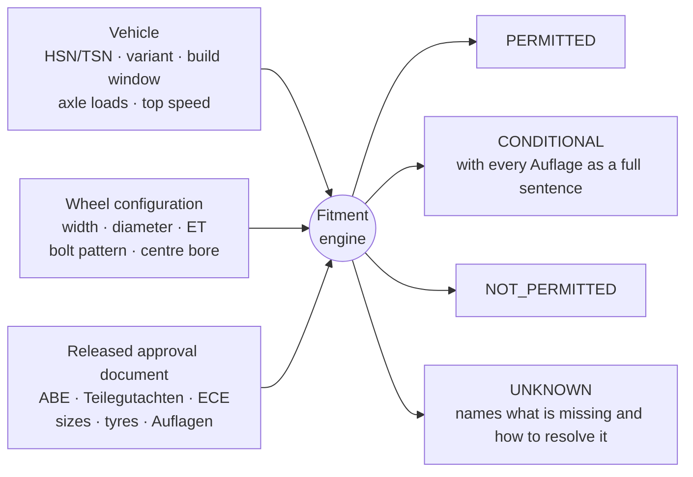

<div align="center">

# RIMIFY

### Alloy wheels and tyres for German cars — shown only when a type-approval document says they fit.

[](https://laravel.com)
[](https://www.php.net)
[](https://vuejs.org)
[](https://inertiajs.com)
[](https://www.typescriptlang.org)

[](https://dev.mysql.com)
[](https://mariadb.org)
[](https://vite.dev)
[](https://stripe.com)
[](https://pestphp.com)
[](https://vitest.dev)
[](https://playwright.dev)
[](https://github.com/larastan/larastan)
[](https://laravel.com/docs/pint)

[](https://github.com/skillLeo/rimify/commits/main)
[](https://github.com/skillLeo/rimify/graphs/commit-activity)
[](https://github.com/skillLeo/rimify)
[](#licence)

[**Live preview**](https://rimify.skillleo.com) · [How it decides](#how-rimify-decides) · [Features](#features) · [Getting started](#getting-started) · [Engineering guide](CONTRIBUTING.md) · [Decision log](docs/decisions.md)

</div>

---

> **RIMIFY may be silent. RIMIFY may be cautious. RIMIFY may say it does not know.**
> **RIMIFY may never be confidently wrong.**

## Why RIMIFY exists

RIMIFY is an online shop for alloy wheels (*Felgen*), tyres and complete wheels (*Kompletträder*) for the
German market. The customer says which car they drive, and the shop shows **only the wheels that are
legally approved for that exact vehicle** under a German type-approval document — an ABE, a
Teilegutachten or an ECE approval.

In Germany a wheel is not compatible because it physically bolts on. It is compatible because a specific
document says so: for one vehicle variant, in one rim width and offset, with one tyre size, and sometimes
only under stated conditions (*Auflagen*). Fitting the wrong wheel costs the driver their
*Hauptuntersuchung* and their insurance cover.

So RIMIFY does not store compatibility as a product attribute. **Compatibility is a relationship between
a vehicle, a wheel configuration and an approval document**, and that relationship is the primary object
in the database. Everything the customer sees is derived from it.

## At a glance

| | |
|---|---|
| **4-state verdict** | `PERMITTED` · `CONDITIONAL` · `NOT_PERMITTED` · `UNKNOWN` — never a boolean |
| **275 routes** | 39 storefront routes, 202 admin routes across 33 areas |
| **246 Vue components** | server-side rendered, with phone layouts throughout |
| **98 migrations** | MySQL 8.4 and MariaDB 11.8, strict mode, triggers and CHECK constraints |
| **2,400+ feature tests** | run on both database engines, beside 650+ unit tests |
| **1,700+ component tests** | Vitest, plus 160 Playwright specs on desktop, in-between widths and phones |
| **300+ recorded decisions** | every product and engineering choice in [`docs/decisions.md`](docs/decisions.md) |

## How RIMIFY decides



The compatibility core lives in [`app/Domain/Fitment`](app/Domain/Fitment) and depends on no HTTP,
Inertia or Vue code. The listing, the product page, the RIMIFY-Check, the basket, the checkout and the
admin all call the same service, so there is exactly one answer to "does this fit?".

| Guarantee | How it is enforced |
|---|---|
| **Fails closed** | Missing or unparseable data — a document not yet released, an axle load that could not be read — always leads to a cautious answer, never an optimistic one. |
| **Unknown is not no** | `UNKNOWN` says what is missing, why, and what would resolve it. It is never shown as a refusal. |
| **Tyres from the car's own figures** | The minimum load index comes from the permitted axle loads, the speed symbol from the top speed. Where the document states its own minimum, the stricter one governs and the verdict records which source was used. A combined verdict is never better than its tyre part. |
| **One car, never a guess** | A key-number lookup returns a collection. More than one match always leads to a choice step. |
| **Build windows** | `build_to IS NULL` means still in production, never "today". The overlap logic is written once. |
| **An order remembers why** | The verdict behind each order line is frozen at purchase. Snapshots and the audit log are append-only, enforced by database triggers that are tested on the production engine. |
| **Say only what is on record** | Every sentence that denies or restricts something in a document's name is backed by a recorded field, checked by a test ledger. |
| **Server-side permissions** | Every admin mutation passes a Policy. The interface only hides. |

## Features

### Storefront

- **Find your car in seconds** — by make, model and variant, by **HSN/TSN**, or by photographing the
  *Zulassungsbescheinigung*. The photo is read on the device with Tesseract and never leaves the browser.
- **Only approved wheels** — listings filtered by released documents, a verdict for every size,
  *Auflagen* as full German sentences, and the approval document itself as a PDF.
- **Komplettrad configurator** — tyres matched to the load index and speed symbol each axle needs,
  staggered fitments front and rear, balance-weight colours and TPMS sensors (*RDKS*).
- **RIMIFY-Check** — for wheels the customer already owns, with a shareable, printable result.
- **Compare, wheel calculator, guides and FAQ** — *Vergleich*, *Felgenrechner*, *Ratgeber*, blog.
- **Checkout** — Stripe, plus a built-in test-payment sandbox; PDF invoices in a gap-free § 14 UStG
  series, small-business (§ 19 UStG) support, the withdrawal form, an order status page, a customer
  account and verified-purchase reviews.
- **Made for Germany** — German throughout with the informal *du*; `1.425,00 €`, `8,5J`, `66,6 mm`,
  `245/45 R18 92Y` formatted the German way by one helper; terms of art never translated.

### Admin

- **Approval documents** — intake of a *Gutachten* with its vehicles, wheel configurations, tyre sizes and
  *Auflagen*, a customer-eye preview, and a release step.
- **Coverage, conflicts and demand** — which cars are covered, where two documents disagree, and what
  customers searched for and did not find.
- **Catalogue** — wheels, tyres, brands, balance weights, TPMS and accessory prices, and the vehicle import.
- **Orders** — refunds, chargebacks, reviews, messages and enquiries.
- **Content** — pages, navigation and FAQ.
- **Access** — users, roles and permissions, invitations, and the password asked again before anything
  that moves money.
- **Protokoll** — an append-only audit log, written in plain German.
- **System** — a guarded reset for test environments, with a verified backup first.

## Architecture

```
app/
├── Domain/
│   ├── Fitment/      the compatibility engine: resolver, verdicts, tyre eligibility, derivations
│   ├── Approval/     approval-document lifecycle and supersession
│   └── Storefront/   device detection, vehicle context, header state
├── Http/             controllers, middleware, Form Requests (storefront and admin)
├── Services/         storefront, commerce, admin, content and mail services
├── Payments/         Stripe and the test-payment sandbox
├── Policies/ · Models/ · Enums/ · Support/
database/
├── migrations/       grouped by bounded context
└── seeders/          reference tables, vehicles, catalogue, approvals, content, access
resources/
├── js/Pages/         one Inertia page per screen
├── js/Components/    the component library
└── css/tokens.css    the design system — every value a component uses
tests/                Pest unit and feature tests
e2e/                  Playwright end-to-end suites
docs/                 decisions, design direction, specs, reviews
```

**Rendering.** Every page is server-side rendered through Inertia SSR. The device split and the header
state are decided on the server and shipped in the first response, so nothing shifts after hydration.

**Design system.** No utility framework: one token file, [`resources/css/tokens.css`](resources/css/tokens.css),
governed by [`docs/design/DIRECTION.md`](docs/design/DIRECTION.md), defines the whole visual language.

## Tech stack

| Layer | Technology |
|---|---|
| Backend | Laravel 13 · PHP 8.3+ · Sanctum · Scout · Spatie Permission, Activitylog, Media Library, Backup, Sitemap |
| Frontend | Inertia 3 with SSR · Vue 3.5 · TypeScript 6 · Pinia · Reka UI · Vite 8 |
| Data | MySQL 8.4 and MariaDB 11.8 (InnoDB, utf8mb4, strict mode) · Redis via Predis · S3-compatible storage |
| Commerce | Stripe · DomPDF and FPDI for invoices and documents · League CSV and OpenSpout for imports |
| Extras | Tesseract.js for on-device OCR · Three.js via TresJS · d3 for admin charts |
| Quality | Pest 4 · Vitest 5 · Playwright with axe · Larastan level 6 · Pint · ESLint · Stylelint · Lighthouse CI |

## Getting started

### Requirements

- PHP 8.3 or newer with `pdo_mysql`, `mbstring`, `intl` and `gd`
- Composer 2 and Node.js 22 or newer
- MySQL 8.4 or MariaDB 11.8, with strict mode on

### Install

```bash
git clone https://github.com/skillLeo/rimify.git
cd rimify

composer install
npm ci

cp .env.example .env
php artisan key:generate
```

Set the `DB_*` values in `.env`, then create the schema and load the reference and demo data:

```bash
php artisan migrate --seed
```

Payments run on Stripe **test keys only** outside production. Live keys are refused by the code and are
entered by a person in the admin of the production site, nowhere else.

### Run

```bash
npm run build              # client and SSR bundles
node bootstrap/ssr/ssr.js  # the SSR server, in its own terminal
php artisan serve          # http://localhost:8000
```

For front-end work, `npm run dev` starts Vite with hot reloading.

### Test

```bash
composer verify
```

One command runs the whole gate: the secrets scan, Pint, Larastan, Pest with coverage, `vue-tsc`,
Stylelint, ESLint, Vitest with coverage, the production build and the Playwright suite. A change is
finished only when it passes.

| Command | Purpose |
|---|---|
| `composer test` | the PHP suite |
| `composer test:mysql` | the PHP suite on the second database engine |
| `composer verify:fitment` | the fitment engine, held to 100 % line coverage |
| `npm run test` | component tests |
| `npm run e2e` | end-to-end tests |

Feature tests run against a real MySQL-compatible database, never SQLite: the engine relies on triggers,
CHECK constraints and window functions that SQLite would silently accept. The test database is set in
`tests/env.php` and can be pointed elsewhere with `TEST_DB_HOST`, `TEST_DB_PORT` and `TEST_DB_DATABASE`.

## Documentation

| Document | What it holds |
|---|---|
| [`CONTRIBUTING.md`](CONTRIBUTING.md) | the engineering guide |
| [`docs/decisions.md`](docs/decisions.md) | every decision, with its date, reason and commit |
| [`docs/design/DIRECTION.md`](docs/design/DIRECTION.md) | the visual system: palette, type, grid, motion, copy |
| [`docs/review/ADMIN-AUDIT.md`](docs/review/ADMIN-AUDIT.md) | the admin audit: 471 inventory rows, each with its result |

## Security

Never commit a live payment or cloud credential. A key whose prefix marks it as live is refused by the
code, and `php artisan secrets:scan` runs in `composer verify` and in the pre-commit hook.

If you find a vulnerability, please report it privately through GitHub's
[private vulnerability reporting](https://github.com/skillLeo/rimify/security/advisories/new) rather than
in a public issue.

## Licence

Proprietary. Developed by SkillLeo SMC (Pvt) Ltd for RIMIFY. All rights reserved.

The source is published for reference. No licence to use, copy, modify or distribute it is granted.
