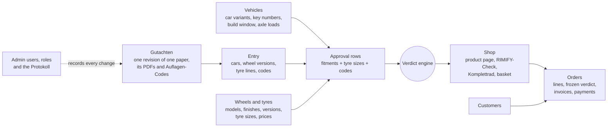
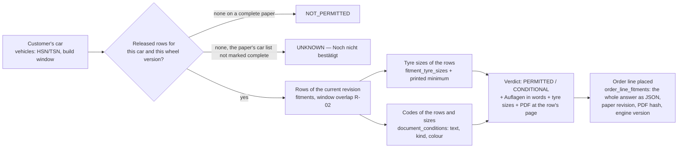
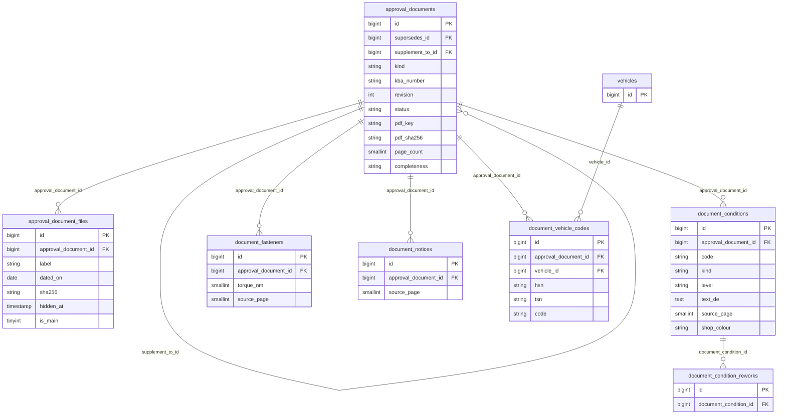
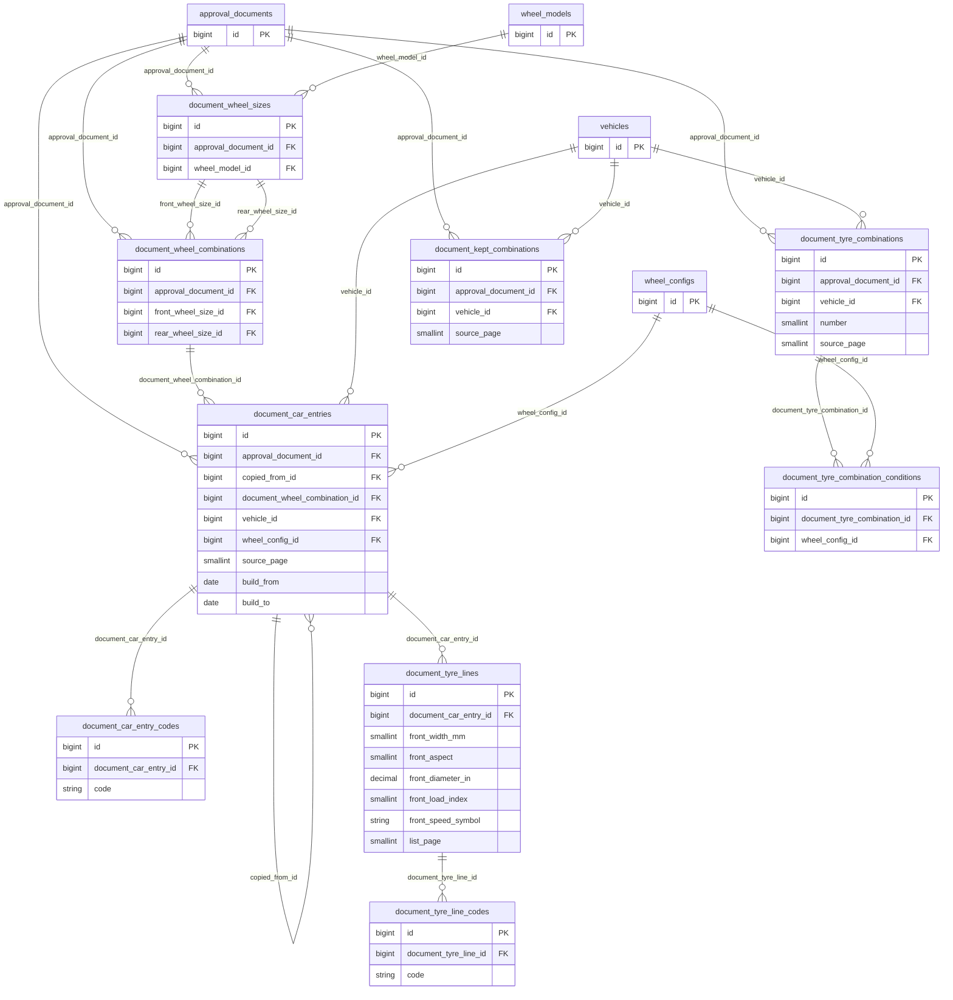
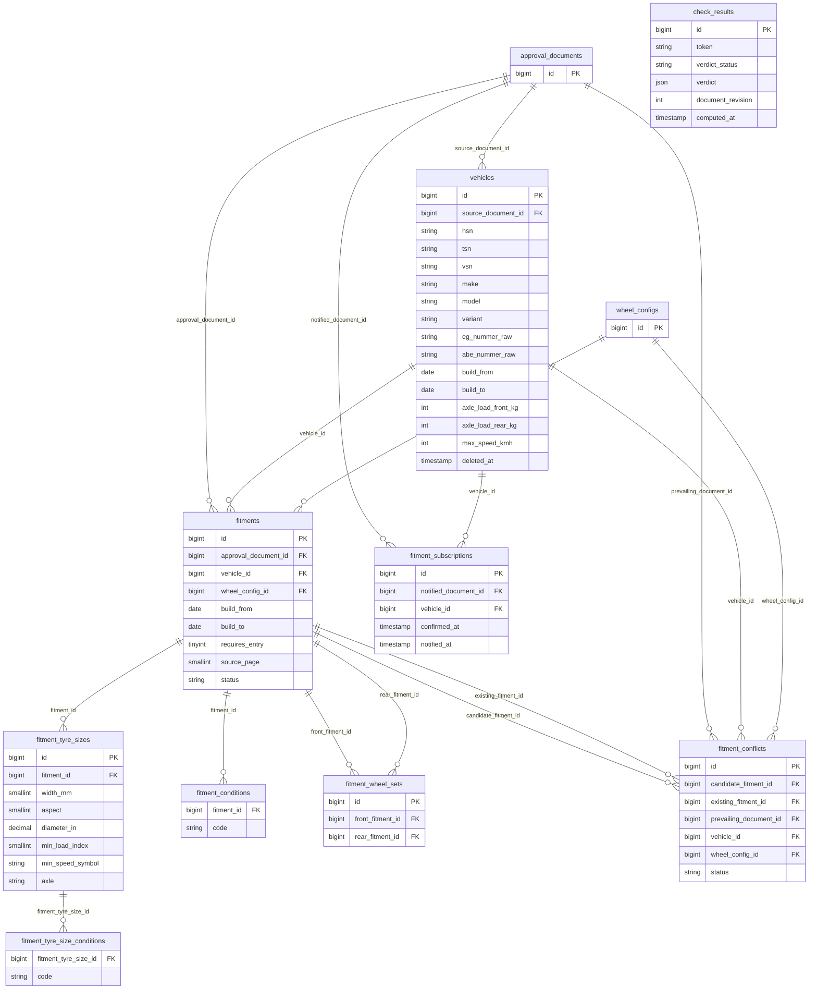
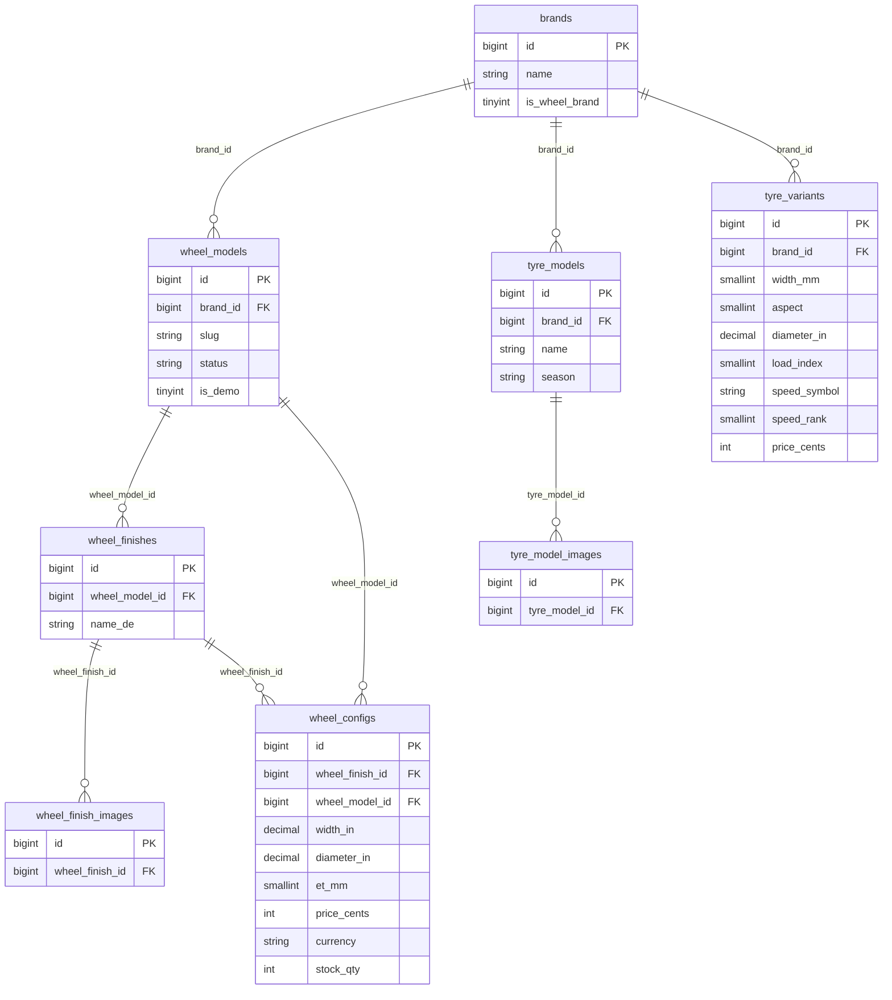
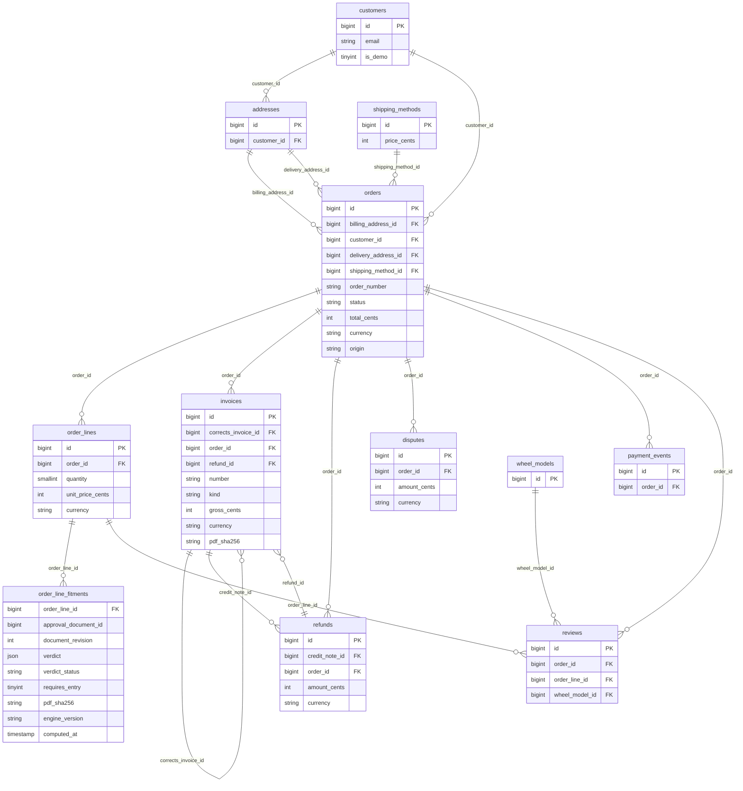
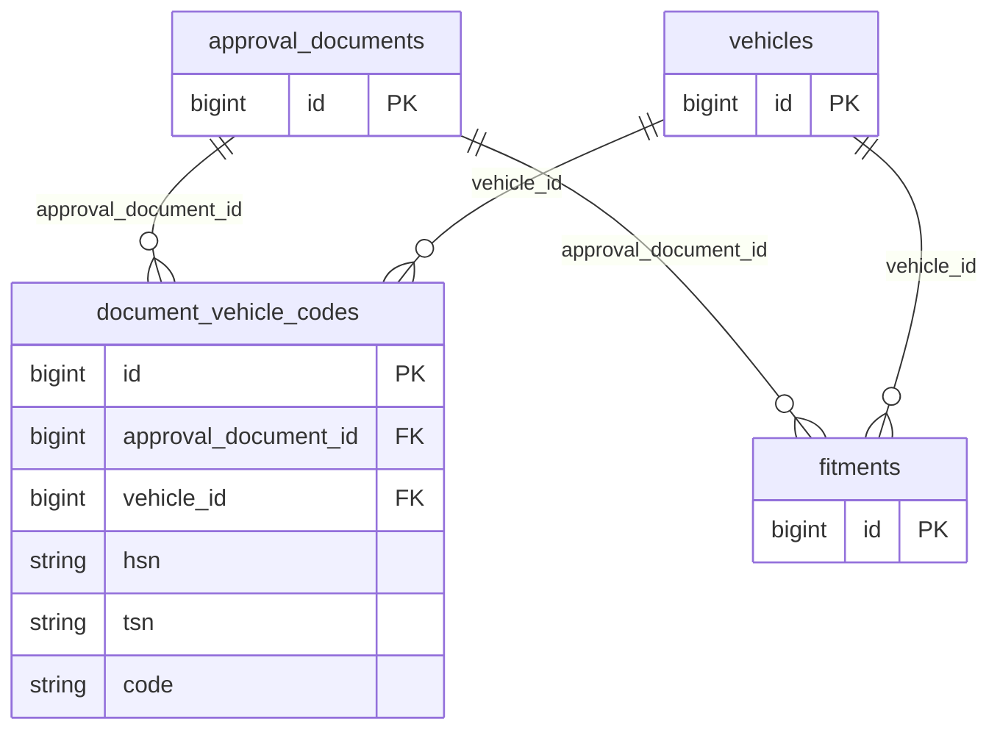
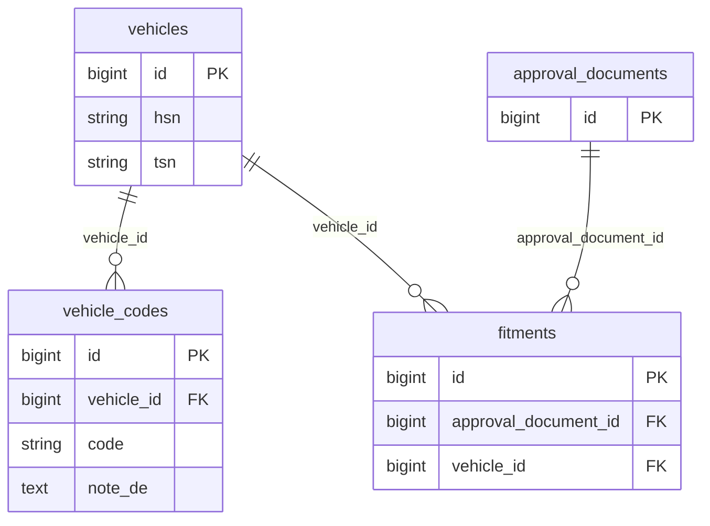

# RIMIFY — data model

Generated from the schema of the migrated gate database (last migration `2026_11_21_000300_vehicle_abe_number`): 97 tables, 110 foreign keys, 28 triggers. Schema only — no rows, no names, no settings.

## One page: the building blocks

A **vehicle** is one car variant, found by its key numbers (HSN/TSN) and told apart by its build window. A **Gutachten** is
one approval paper — ABE, Teilegutachten, ECE or Nachtrag — kept per **revision**: a change after release is a new revision,
never an edit. From each paper the admin enters, step by step, the **wheel versions** it names, the **cars**, the **tyre
lines** and the **Auflagen-Codes** with their words as printed. Releasing the paper writes **approval rows** (`fitments`):
this paper permits this wheel version on this car, with these tyre sizes and these codes. The **catalogue** holds what is
sold: wheel models in finishes and versions, tyre models in sizes. The **verdict engine** reads only released rows and
answers one question — may this car have this wheel, and with which tyres — in four states (R-07). An **order** freezes that
answer with each line, so a later change to a paper never changes what a customer was told. **Admin users** act through
roles, and every change they make is written to the **Protokoll** in words.

**Rules the database itself enforces**

- *Append-only* (a trigger refuses UPDATE and DELETE): the Protokoll (`audit_logs`), the frozen verdicts (`order_line_fitments`),
  invoices and their numbers, payment events (their raw content). Why: they are evidence — of what was said, sold and paid. An
  issued RIMIFY-Check (`check_results`) is never changed either; it is removed once its stated validity has passed.
- *Frozen after release* (enforced in code, server-side, R-11): a released paper and everything entered from it. Why: an order
  points at a revision and a PDF hash; changing a released paper would change history. Only a new revision changes it — the
  shop level of an Auflage (its colour) and the paper's further PDFs are the two things a released paper allows.
- *Soft-deleted only*: vehicles (R-04). Why: rows and orders keep pointing at them.
- *RESTRICT* on every link from an approval row to its paper, car and wheel version (R-05): tidying the catalogue can never
  take compliance data with it.

### Where the schema and the written rules differ

Checked against the migrated schema; each line says which side is right.

| Rule or document | What the schema has | Which is right |
|---|---|---|
| R-05 says every foreign key out of `fitments` is RESTRICT | Its links to the paper, the car and the wheel version are RESTRICT; `fitments.created_by` → `admin_users` is SET NULL | **The schema**, by R-05's own reason („compliance data never disappears as a side effect of tidying a catalogue“): an admin account going takes no row with it, only the name of who wrote it. R-05's wording is wider than its intent; changing CLAUDE.md is the operator's to decide. |
| §8: every measurement column carries its unit in the name | `fitments.permitted_width_min/max` and `document_car_entries.permitted_width_min/max` (inches), `fitments.permitted_et_min/max` and `document_car_entries.permitted_et_min/max` (mm), `media.size` (bytes) carry none | **The rule.** The values are right and read right; only the names lack the unit. A rename is a migration across the entry, the engine and the tests, not done here. |
| The count of the Verwendungsbereich (D-249) | `approval_documents.counted_codes_page` and `counted_sizes_page` are still there, not asked, shown or compared since D-440; `counted_axle_limit_page` is stored and never read | **D-440.** The columns are dead data kept for the Protokoll of older releases; nothing reads them. |

## How a verdict is made

The frozen answer has no foreign key to the car, the rows or the paper: it stands on its own, and a trigger refuses any change
to it. A later revision of the paper, a corrected car or a retired wheel leaves it as it was sold.

## Wie wir Änderungen sicher machen

1. Every schema change is a migration that can be rolled back; the recent ones each have a round-trip test (up, down, up).
2. Before and after each release, every answer the shop gives is dumped and compared one by one (verdict equivalence).
3. The full suite runs on both database engines (MariaDB 11.8 and MySQL 8.4) before anything ships.
4. A paper reaches the shop only through the release door, which refuses a paper whose entry is incomplete or contradicts itself.
5. Every release takes a backup first and names its rollback point.

<h2 class="area">Vehicles and import</h2>

Every car the shop can answer for, and the runs that bring cars in from a file.

*The vehicles stand in the diagram „Vehicles, approval rows and answers“, beside the rows that name them.*

| Table | What it is for | Key fields | Points to | Rule |
|---|---|---|---|---|
| `vehicles` | One car variant: key numbers, name, EG number, the national ABE number of an older car (information only, D-502), build window, axle loads, top speed. Soft-deleted, never deleted (R-04). | `hsn`, `tsn`, `vsn`, `make`, `model`, `variant`, `eg_nummer_raw`, `abe_nummer_raw`, `build_from`, `build_to`, `axle_load_front_kg`, `axle_load_rear_kg`, `max_speed_kmh`, `deleted_at` | `approval_documents` | soft-deleted only |
| `vehicle_imports` | One import run: the file, its stage (uploading … applied / failed), its counts. | `file_name`, `source`, `status`, `rows_total`, `error` | `admin_users` |  |
| `vehicle_import_rows` | One line of an import run, with what the dry run decided for it and why. | `line`, `status`, `reason`, `number` | `vehicle_imports` |  |
| `vehicle_import_stage` | Cars of a run waiting to be written, one batch at a time. | `hsn`, `tsn`, `variant` | — |  |
| `catalogue_gap_events` | A customer asked for a car or size the shop could not answer: the demand list. | `hsn`, `tsn`, `reason_code`, `occurred_at` | — |  |
| `fitment_subscriptions` | „Sag mir Bescheid“: a customer waits to hear when a paper covers his car. | `vehicle_id`, `confirmed_at`, `notified_at` | `approval_documents`, `vehicles` |  |

<h2 class="area">Gutachten and their entry</h2>

One approval paper (ABE, Teilegutachten, ECE, Nachtrag) per revision, and what the admin typed from it, step by step.

**The paper itself**

**The entry, step by step**

| Table | What it is for | Key fields | Points to | Rule |
|---|---|---|---|---|
| `approval_documents` | One revision of one paper: its kind, number, issuer, dates, PDF and hash, status (draft → published → superseded). Changes after release only by a new revision. | `kind`, `kba_number`, `revision`, `status`, `supersedes_id`, `supplement_to_id`, `pdf_key`, `pdf_sha256`, `page_count`, `completeness` | `admin_users`, `approval_documents` | frozen after release |
| `approval_document_files` | Further PDFs of a paper (Nachtrag, Anlage, older version) with label, date, place and hash; hidden, never deleted (D-494). | `label`, `dated_on`, `sha256`, `hidden_at`, `is_main` | `admin_users`, `approval_documents` |  |
| `document_conditions` | The paper's Auflagen-Codes with their text as printed, kind and page. | `code`, `kind`, `level`, `text_de`, `source_page`, `shop_colour` | `admin_users`, `approval_documents` | frozen after release |
| `document_condition_reworks` | Work on the car a code asks for (Bördeln, Kotflügel …), as the paper words it. | — | `document_conditions` | frozen after release |
| `document_fasteners` | Bolts and nuts the paper prescribes, with torque and page. | `torque_nm`, `source_page` | `approval_documents` | frozen after release |
| `document_notices` | The paper's mandatory notices, as printed. | `source_page` | `approval_documents` | frozen after release |
| `document_wheel_sizes` | The wheel versions the paper names (step 2). | — | `approval_documents`, `wheel_models` | frozen after release |
| `document_wheel_combinations` | Front and rear wheel version taken together (step 3). | — | `approval_documents`, `document_wheel_sizes` | frozen after release |
| `document_car_entries` | One car on one wheel combination, as entered (step 4): its page, window, permitted width and ET. | `vehicle_id`, `wheel_config_id`, `source_page`, `build_from`, `build_to` | `admin_users`, `approval_documents`, `document_car_entries`, `document_wheel_combinations`, `vehicles`, `wheel_configs` | frozen after release |
| `document_car_entry_codes` | The Auflagen-Codes of one car entry. | `code` | `document_car_entries` | frozen after release |
| `document_tyre_lines` | One tyre line of a car entry: front and rear size, load index and symbol as typed, page of the list. | `front_width_mm`, `front_aspect`, `front_diameter_in`, `front_load_index`, `front_speed_symbol`, `list_page` | `document_car_entries` | frozen after release |
| `document_tyre_line_codes` | The codes of one tyre line. | `code` | `document_tyre_lines` | frozen after release |
| `document_tyre_combinations` | The paper's pairing table: which front size goes with which rear size, per car type. | `number`, `source_page` | `approval_documents`, `vehicles` | frozen after release |
| `document_tyre_combination_conditions` | The codes of one pairing, per wheel version. | — | `document_tyre_combinations`, `wheel_configs` | frozen after release |
| `document_kept_combinations` | Combinations kept from an earlier entry, „übernommen, bitte prüfen“. | `source_page` | `approval_documents`, `vehicles` | frozen after release |
| `document_vehicle_codes` | A car's „Allgemeine Codes“ under this paper (D-452, D-474 — point 9). | `hsn`, `tsn`, `code` | `approval_documents`, `vehicles` | frozen after release |

<h2 class="area">Rows the engine reads, and its answers</h2>

What a release writes from the entry: the rows the verdict engine reads, and what it keeps of its answers.

**Vehicles, approval rows and answers**

| Table | What it is for | Key fields | Points to | Rule |
|---|---|---|---|---|
| `fitments` | One approval row: this paper permits this wheel version on this car, with its window, ET band, page and whether an Eintragung is needed. All its catalogue links are RESTRICT (R-05). | `approval_document_id`, `vehicle_id`, `wheel_config_id`, `build_from`, `build_to`, `requires_entry`, `source_page`, `status` | `admin_users`, `approval_documents`, `vehicles`, `wheel_configs` | frozen after release |
| `fitment_tyre_sizes` | One tyre size a row permits, per axle, with the paper's printed minimum load index and speed symbol. | `width_mm`, `aspect`, `diameter_in`, `min_load_index`, `min_speed_symbol`, `axle` | `fitments` | frozen after release |
| `fitment_tyre_size_conditions` | The codes that hold for one tyre size only. | `code` | `fitment_tyre_sizes` | frozen after release |
| `fitment_conditions` | The codes that hold for a whole row. | `code` | `fitments` | frozen after release |
| `fitment_wheel_sets` | Two rows sold as one set: one wheel version front, another rear. | — | `fitments` | frozen after release |
| `fitment_conflicts` | Two papers answering the same car and wheel differently, and which one prevails. | `status` | `admin_users`, `approval_documents`, `fitments`, `vehicles`, `wheel_configs` |  |
| `verdict_tallies` | Counts of answers given, for the admin's figures. | — | — |  |
| `check_results` | A RIMIFY-Check printed or shared: the answer frozen at the moment it was issued. Never updated; removed after its validity. | `token`, `verdict_status`, `verdict`, `document_revision`, `computed_at` | — | append-only |
| `load_index_table` | ETRTO: load per tyre for each load index (reference data). | — | — | reference data |
| `speed_symbol_table` | ETRTO: speed symbols and their rank (reference data). | — | — | reference data |

<h2 class="area">Wheels, tyres and the catalogue</h2>

What the shop sells: wheel models in finishes and versions, tyre models in sizes, and the extras of a Komplettrad.

**Wheels and tyres**

| Table | What it is for | Key fields | Points to | Rule |
|---|---|---|---|---|
| `brands` | A maker of wheels or tyres, with its GPSR details. | `name`, `is_wheel_brand` | — |  |
| `wheel_models` | A wheel model (the product page): name, Radtypenbezeichnung, status. | `slug`, `status`, `is_demo` | `brands` |  |
| `wheel_finishes` | A colour of a wheel model. | `name_de` | `wheel_models` |  |
| `wheel_finish_images` | The photographs of one finish. | — | `wheel_finishes` |  |
| `wheel_configs` | One version a customer buys: width, diameter, ET, bolt pattern, bore, price, stock. | `width_in`, `diameter_in`, `et_mm`, `price_cents`, `currency`, `stock_qty` | `wheel_finishes`, `wheel_models` |  |
| `tyre_models` | A tyre model: brand, name, season, photos. | `name`, `season` | `brands` |  |
| `tyre_model_images` | The photographs of one tyre model. | — | `tyre_models` |  |
| `tyre_variants` | One tyre size of a model: size, load index, speed symbol and its rank, EU label, price. | `width_mm`, `aspect`, `diameter_in`, `load_index`, `speed_symbol`, `speed_rank`, `price_cents` | `brands` |  |
| `balance_weight_colours` | Colours of balance weights a Komplettrad can have. | `name_de`, `surcharge_cents`, `currency` | — |  |
| `tpms_sensor_prices` | RDKS sensor prices per car make. | `price_cents` | — |  |
| `shipping_methods` | Ways to ship, with price and delivery time; switched off, never deleted. | `price_cents` | — |  |
| `catalogue_imports` | A supplier feed run (Katalog › Import), taken back whole if wrong. | `status` | `admin_users` |  |
| `media` | Uploaded files and pictures of the content pages. | `size` | — |  |
| `demand_marks` | Brands and sizes the admin marked as wanted. | — | `admin_users`, `brands` |  |

<h2 class="area">Customers, orders and money</h2>

Who bought what, the answer frozen with each line, and the money: invoices, payments, refunds.

**Customers, orders and money**

| Table | What it is for | Key fields | Points to | Rule |
|---|---|---|---|---|
| `customers` | A buyer (guest or with an account). | `email`, `is_demo` | — |  |
| `customer_accounts` | A customer's sign-in. | — | — |  |
| `addresses` | A delivery or billing address of a customer. | — | `customers` |  |
| `orders` | One order: number, status, totals in cents and currency, addresses, shipping. | `order_number`, `status`, `total_cents`, `currency`, `origin` | `addresses`, `customers`, `shipping_methods` |  |
| `order_lines` | One line of an order: a wheel, a set or a Komplettrad, its quantity and price. | `quantity`, `unit_price_cents`, `currency` | `orders` |  |
| `order_line_fitments` | The verdict frozen with an order line at purchase: paper, revision, PDF hash, the whole answer as JSON. Never updated or deleted (R-12). | `order_line_id`, `approval_document_id`, `document_revision`, `verdict`, `verdict_status`, `requires_entry`, `pdf_sha256`, `engine_version`, `computed_at` | `order_lines` | append-only |
| `invoices` | An invoice or credit note, with its §14 number. Never updated or deleted. | `number`, `kind`, `gross_cents`, `currency`, `pdf_sha256` | `invoices`, `orders`, `refunds` | append-only |
| `invoice_sequences` | The gapless invoice numbers, one per year. | — | — | append-only |
| `invoice_exports` | Copies of Stripe's invoices to the shop's own bucket. | — | — |  |
| `order_number_counter` | The next order number. | — | — |  |
| `payment_events` | What the payment provider reported, as it came. Never changed or deleted. | — | `orders` | append-only |
| `stripe_events` | Webhook events received, each handled once. | — | — |  |
| `refunds` | Money given back on an order. | `amount_cents`, `currency` | `admin_users`, `invoices`, `orders` |  |
| `disputes` | A chargeback on an order. | `amount_cents`, `currency` | `orders` |  |
| `reviews` | A buyer's review of a wheel model, tied to the order line. | — | `admin_users`, `order_lines`, `orders`, `wheel_models` |  |
| `review_feedback` | A buyer's answer to the review invitation. | — | `admin_users` |  |

<h2 class="area">Admin, Protokoll and content</h2>

Who may do what in the admin, what they did, and the shop's own pages and settings.

| Table | What it is for | Key fields | Points to | Rule |
|---|---|---|---|---|
| `admin_users` | A person with admin access. | `email`, `name` | — |  |
| `admin_invitations` | An invitation to become an admin user. | — | `admin_users`, `roles` |  |
| `roles` | A role (Super-Admin, Gutachten-Redaktion …). | — | `roles` |  |
| `permissions` | A right on a module (view, edit, publish …). | — | — |  |
| `role_permissions` | Which role has which right. | — | `roles` |  |
| `role_has_permissions` | Rights of a role (library table). | — | `permissions`, `roles` |  |
| `model_has_roles` | Roles of an admin user (library table). | — | `roles` |  |
| `model_has_permissions` | Direct rights of an admin user (library table). | — | `permissions` |  |
| `saved_views` | A saved filter of an admin list. | — | `admin_users`, `roles` |  |
| `audit_logs` | The Protokoll: every change, who made it, in words. Never updated or deleted (R-12). | `description`, `created_at` | — | append-only |
| `notifications` | Messages to admin users. | — | — |  |
| `settings` | Shop settings (seller, shipping, texts). | `key` | — |  |
| `mail_settings` | The mail transport's settings (Super-Admin only). | — | `admin_users` |  |
| `mail_suppressions` | Addresses the mail provider refuses. | — | `admin_users` |  |
| `payment_settings` | The payment provider's settings (Super-Admin only). | — | `admin_users` |  |
| `storage_settings` | Where files are stored (Super-Admin only). | — | `admin_users` |  |
| `pages` | A content page (legal texts, guides, blog). | — | — |  |
| `page_blocks` | The blocks of a content page. | — | `pages` |  |
| `page_revisions` | Earlier versions of a content page. | — | `pages` |  |
| `nav_items` | Menu entries. | — | — |  |
| `faq_entries` | Questions and answers of „Häufige Fragen“. | — | — |  |
| `contact_messages` | What came through the contact form. | — | `admin_users` |  |
| `search_misses` | Searches that found nothing. | — | — |  |

### System tables

| Table | What it is for |
|---|---|
| `cache` | framework cache |
| `cache_locks` | framework cache locks |
| `sessions` | browser sessions |
| `jobs` | queued work |
| `job_batches` | batches of queued work |
| `failed_jobs` | queued work that failed |
| `migrations` | which schema changes ran |
| `password_reset_tokens` | framework password resets |
| `users` | framework default table, unused by the shop |
| `telescope_entries` | debugging tool (off in production) |
| `telescope_entries_tags` | debugging tool |
| `telescope_monitoring` | debugging tool |

<h2 class="area">Point 9 — general vehicle information (open, the client decides)</h2>

Today (**model A**, D-452, D-474): a car's „Allgemeine Codes“ live in `document_vehicle_codes`, keyed by **paper and car**.
The same car in two papers has two sets; each set shows only under its own paper's answer.

**Model B** (a sketch, not built): the codes keyed by the **car alone**, one set shown under every paper's answer for that car.

What changes with B: one place to type a car's codes; but a code one paper sets for a car would stand under every other
paper's answer for it too. Either way the engine, the orders and the frozen answers stay as they are; B is one new table and
a move of the existing rows.
