# Der goldene Datensatz – eine Felge durch das ganze System

Eine Felge, einmal vollständig durch RIMIFY: vom Lieferanten-Import über das Gutachten bis zur bezahlten
Bestellung mit eingefrorenem Prüfnachweis. So lässt sich an einem Beispiel prüfen, dass jede Station
mit der nächsten zusammenarbeitet, bevor die echten Daten kommen.

**Alles in diesem Durchlauf ist Platzhalter.** Die Felge heißt „Platzhalter Probelauf“, kostet 1,00 €,
das Gutachten trägt die Nummer „PLATZHALTER-GR-1“ und den Aussteller „Platzhalter – kein echtes
Gutachten“, und das PDF sagt auf jeder Seite, dass es kein Gutachten ist. Bezahlt wird mit der
Testzahlung, bei der kein Geld fließt. Nichts davon beschreibt ein echtes Produkt oder ein echtes
Fahrzeug-Gutachten.

Der Durchlauf ist automatisiert (`e2e/golden-record.spec.ts`) und läuft auf der Vorschau jederzeit neu;
bereits Vorhandenes wird wiederverwendet, nur die Bestellung ist jedes Mal neu. Das Fahrzeug wählt der
Test selbst: das erste, das die Gutachten-Suche mit vollständigen Daten anbietet – hier ein Audi A3
Limousine 40 TFSI (HSN 0588 · TSN AKB).

---

## 1 · Katalog › Import

Eine Lieferantendatei mit einer Größe (CSV, Semikolon, Dezimalkomma). Der Import ordnet die Spalten
selbst zu und zeigt im **Probelauf** Zeile für Zeile, was geschehen wird – erst danach wird importiert.
Marke, Modell und Ausführung legt der Import an, wenn es sie noch nicht gibt.

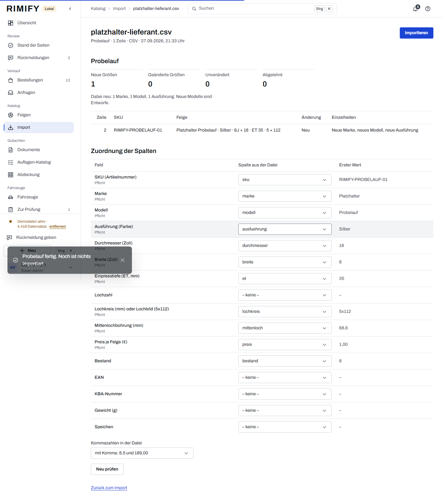
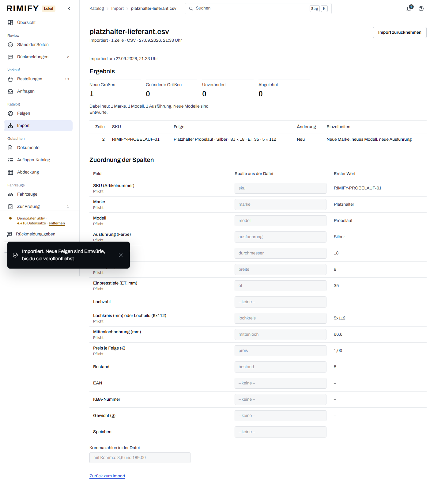

## 2 · Katalog › Felgen: veröffentlichen

Die importierte Felge ist ein Entwurf. Der Freigabe-Check oben nennt, was das Veröffentlichen
verhindert (hier nichts) und was man wissen sollte (kein Produktfoto → der Shop zeigt die Zeichnung).
Jede Testbestellung nimmt Felgen aus dem Bestand; ist er unter zwanzig, füllt der Durchlauf ihn hier
wieder auf hundert auf.

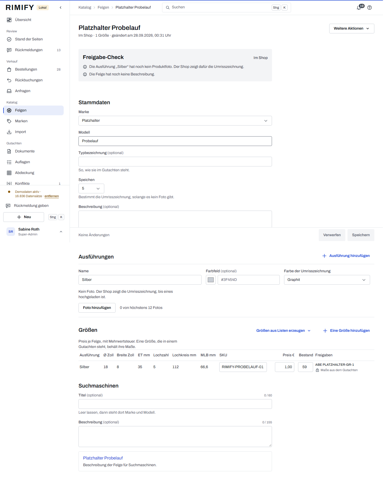

## 3 · Gutachten › Neues Gutachten

PDF, Art (ABE) mit KBA-Nummer, Aussteller und Seitenzahl. Das PDF wird hochgeladen, geprüft (echtes
PDF?) und mit seiner Prüfsumme gespeichert – dieselbe Summe steht später in jeder Bestellung.

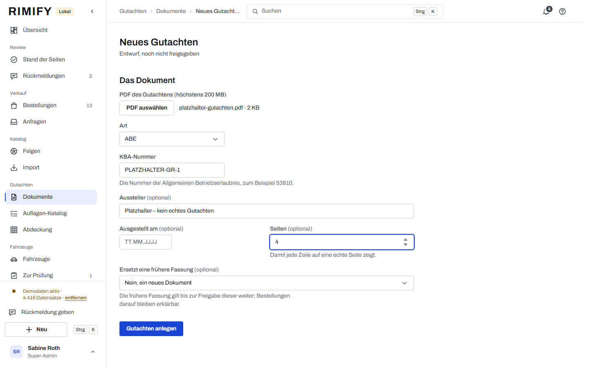

## 4 · Verwendungsbereich

Fahrzeug über HSN/TSN gesucht, die Felgengröße über das Modell, dazu die Reifengröße, eine Auflage aus
dem Auflagen-Katalog (als ganzer Satz) und die Seite im Gutachten, auf der die Zeile steht.

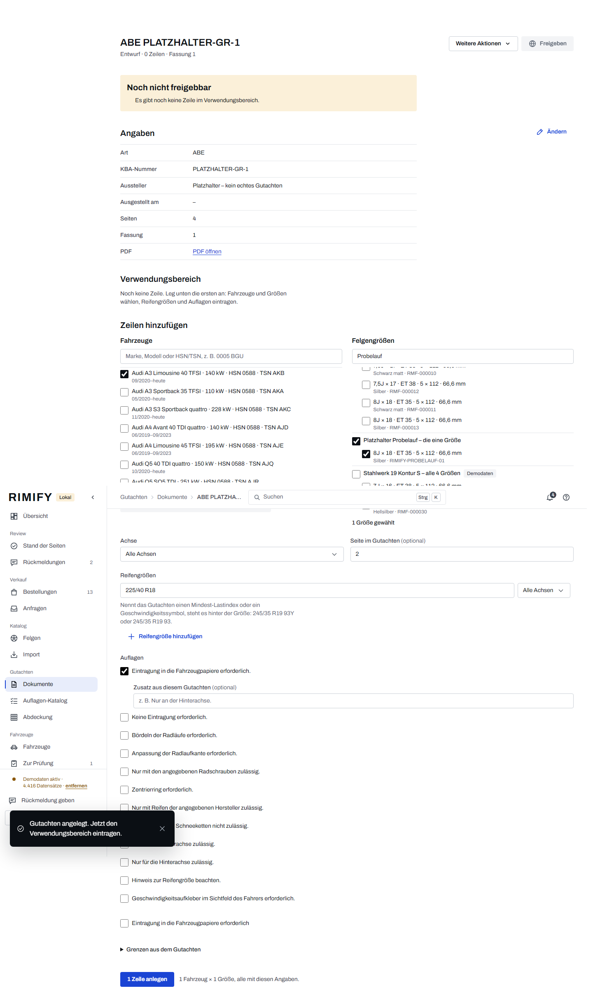
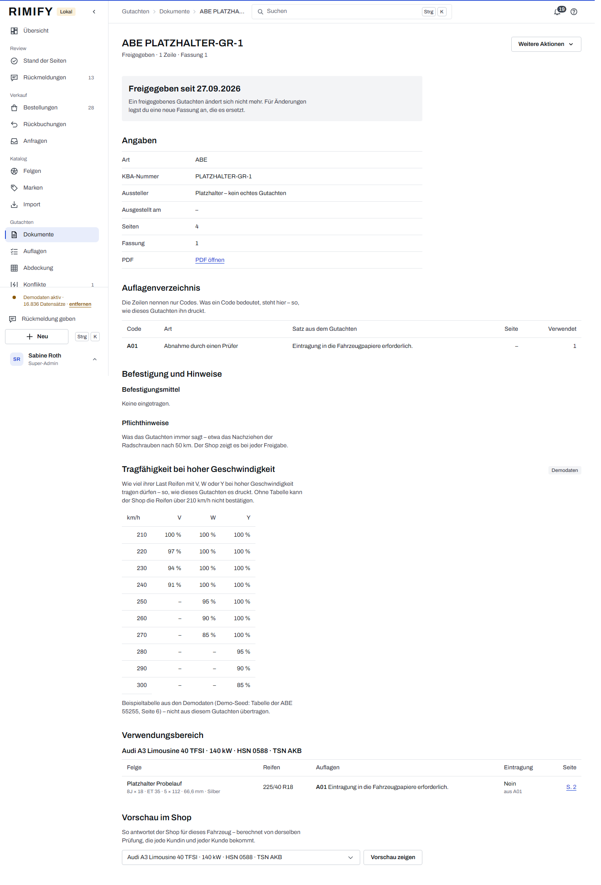

> **Beim ersten Durchlauf gefunden und behoben:** Die Zeile wurde mit der Auflage „Eintragung in die
> Fahrzeugpapiere erforderlich.“ angelegt, das Häkchen „Eintragung erforderlich“ aber nicht gesetzt.
> Der Shop zeigte daraufhin „Keine Eintragung erforderlich.“ direkt über der Auflage, die das Gegenteil
> sagt. Seitdem gilt: Eine solche Auflage macht die Eintragung verbindlich (die vorsichtigere Antwort
> gewinnt), und beim Anlegen wird der Widerspruch mit einem Satz zurückgewiesen. Die Zeile dieses
> Datensatzes stammt aus dem ersten Durchlauf; ein freigegebenes Gutachten ändert sich nicht mehr.

## 5 · Vorschau im Shop

Vor der Freigabe: Was der Shop für dieses Fahrzeug antworten wird – berechnet von derselben Prüfung,
die jede Kundin und jeder Kunde bekommt.

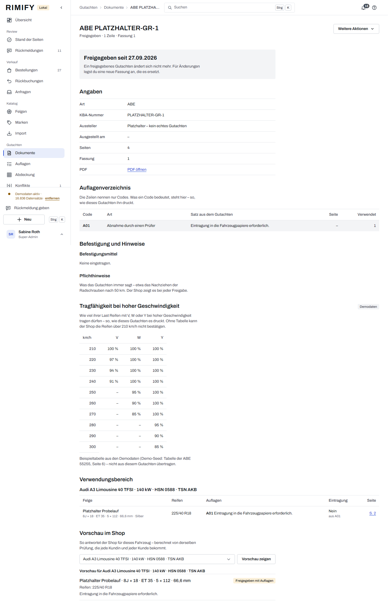

## 6 · Freigeben

Das ganze Gutachten auf einmal; ab jetzt ändert es sich nicht mehr (Änderungen kommen als neue Fassung).

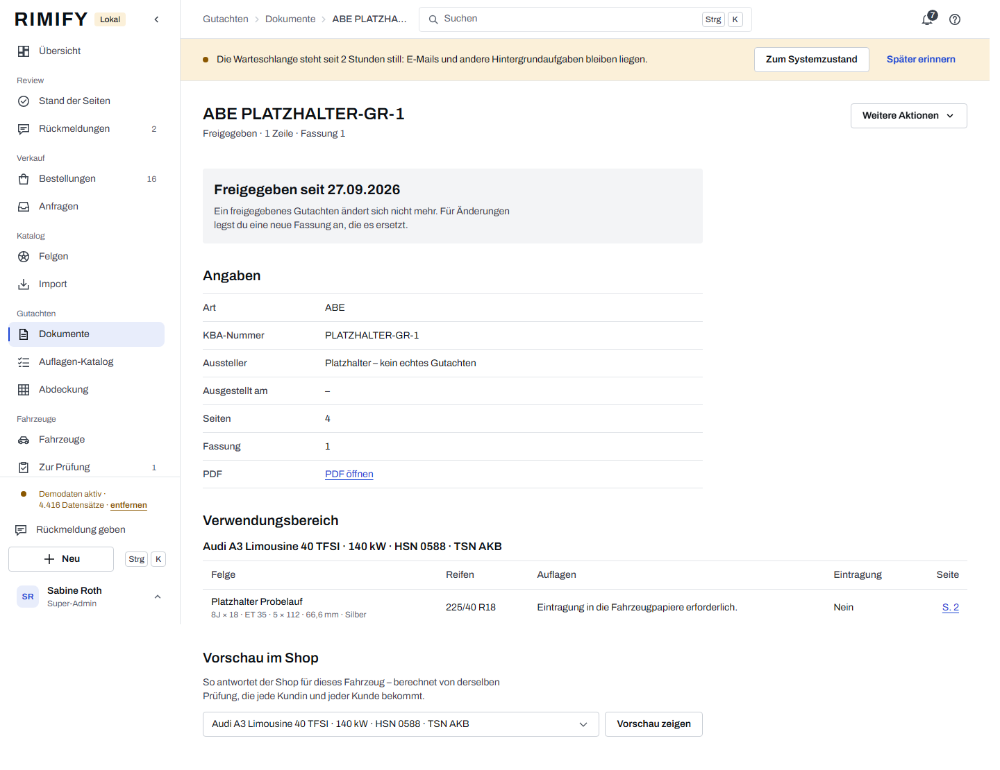

## 7 · Shop: Fahrzeug über HSN/TSN

## 8 · Shop: Felge mit Prüfergebnis, Auflage und Gutachten

Die Liste zeigt nur Felgen mit gültigem Gutachten für dieses Fahrzeug. Auf der Produktseite: „Mit
Auflagen freigegeben für Audi A3 Limousine 40 TFSI“, die Auflage als ganzer Satz, die passende
Reifengröße – und der Link „Gutachten öffnen (PDF, Seite 2)“, der das PDF genau auf der Seite öffnet,
auf der die Zeile steht. Preis: 1,00 € pro Felge, 4 Felgen: 4,00 €.

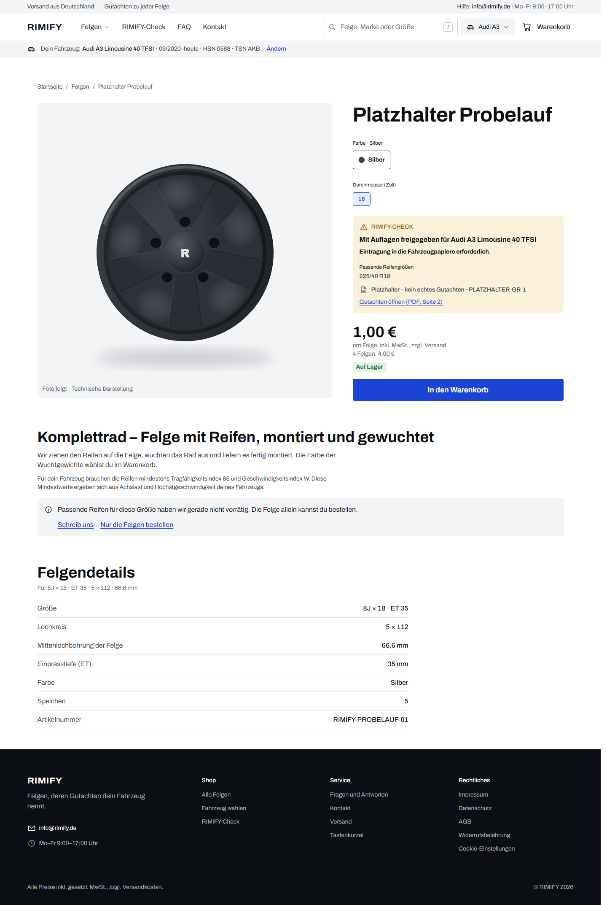

> **Beim Durchlauf gefunden und behoben:** Die Produktkarten teilten den Felgenpreis durch vier
> (1,00 € wurde als „ab 0,25 € pro Felge“ gezeigt), und die Produktseite schrieb den Preis einer Felge
> unter „für 4 Felgen“. Warenkorb, Bestellung und Admin rechneten richtig. Jetzt zeigt der Shop überall
> den Preis einer Felge, auf der Produktseite zusätzlich die Summe für vier.

## 9 · Warenkorb, Kasse, Testzahlung

Die Kasse sagt vor dem Bestellen, dass es eine Testbestellung ist. Die Testzahlungsseite ersetzt den
Zahlungsanbieter: Zahlung erfolgreich, abgelehnt oder abgebrochen – es wird kein Geld bewegt. Sie gibt
es nur auf der Vorschau; im Live-Shop ist sie abgeschaltet.

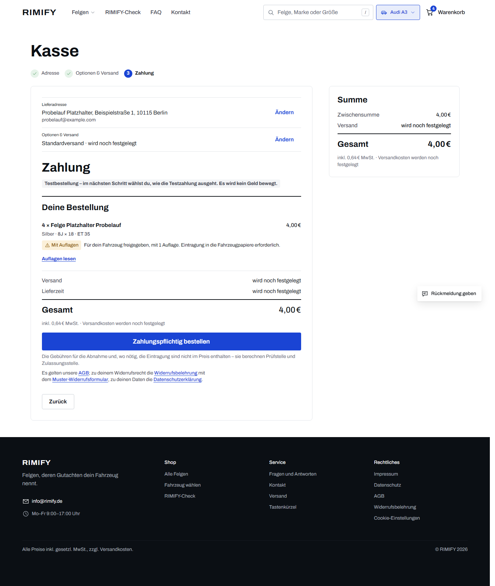
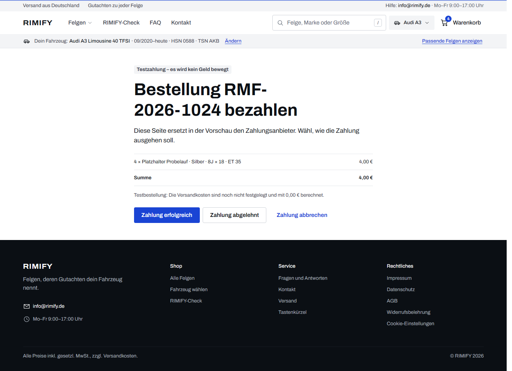

> **Beim zweiten Durchlauf gefunden und behoben:** Die nächste Bestellnummer wurde als Text statt als
> Zahl bestimmt und kollidierte mit einer vorhandenen; die Datenbankmeldung erschien dabei auf der
> Kassenseite. Jetzt wird als Zahl gezählt, und auf der Kasse erscheint nur noch ein deutscher Satz,
> nie eine technische Meldung.

## 10 · Bestellbestätigung

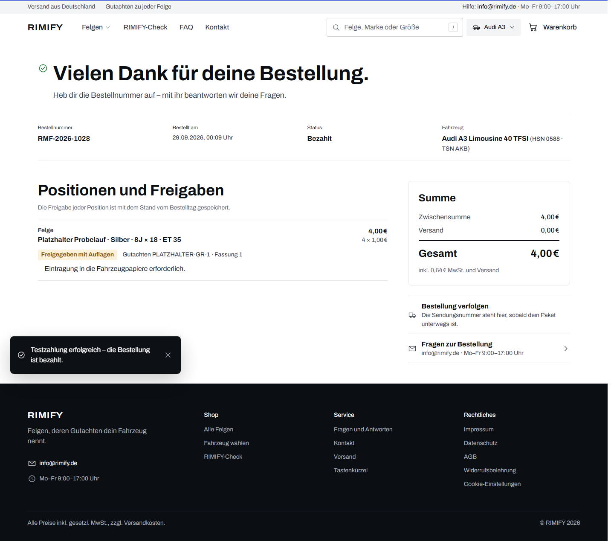

## 11 · Verkauf › Bestellung: der eingefrorene Prüfnachweis

Im Admin steht die Bestellung mit „Bezahlt · Testzahlung“ und pro Felgenposition dem Prüfnachweis, so
wie er im Moment des Kaufs galt: Status, Fahrzeug, Gutachten mit Fassung und Seite, Reifen,
Eintragung, Prüfversion und PDF-Prüfsumme. Er wird nie neu berechnet – ändert sich das Gutachten
später, bleibt nachvollziehbar, was die Kundin oder der Kunde gesehen hat.

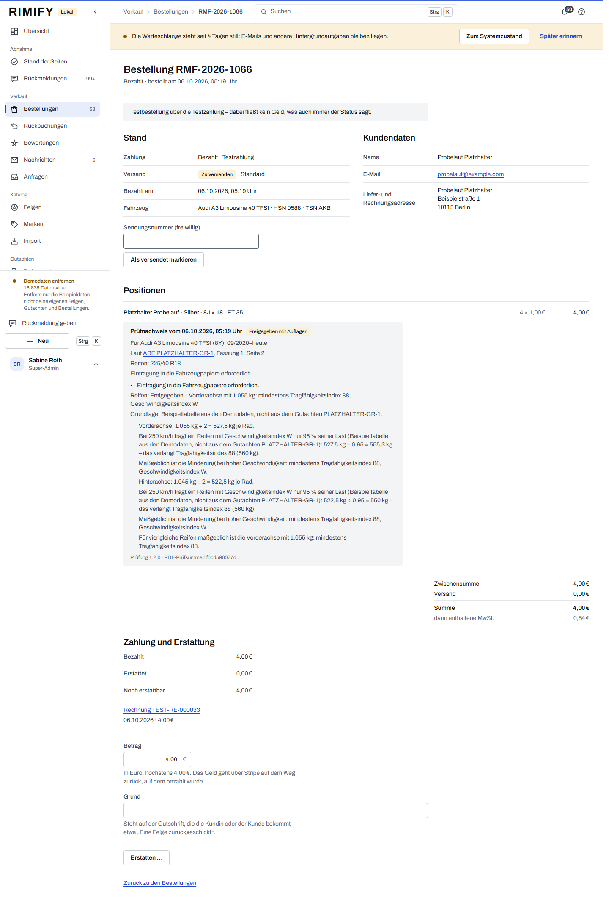

---

## Beispieldaten entfernen

`php artisan demo:purge` entfernt die Beispiel-Bestellungen, -Kundschaft, -Zahlen und -Protokolleinträge und
den Beispielkatalog: die erfundenen Felgen mit Farben und Größen, die Beispiel-Gutachten mit ihren Zeilen, die
Beispielreifen, die erfundenen Marken und die Platzhalterzeichnungen. Darüber schreibt er einen
Protokolleintrag. Der goldene Datensatz bleibt: Er ist echt angelegt, nicht als Beispiel (Tests
`tests/Feature/Admin/DropInTest.php`, `tests/Feature/Demo/DemoCataloguePurgeTest.php`). Danach kommen die echten
Dateien über denselben Weg wie hier: Import → Zuordnung → Probelauf → Importieren.
